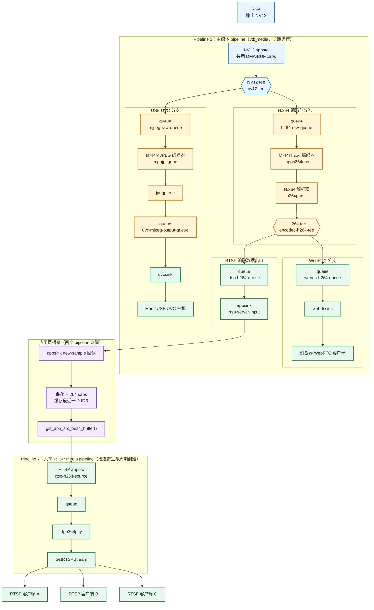
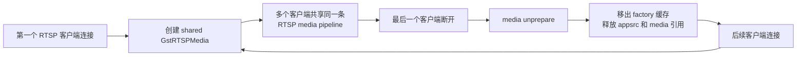

# GStreamer 媒体 Pipeline 全貌

本文说明 Live2D 的 NV12 画面进入 GStreamer 后，如何同时输出 WebRTC、RTSP 和
USB UVC。图中大框表示独立的 GStreamer pipeline，箭头表示 Buffer 的流动方向。

## Pipeline 框型图

## Pipeline 边界

- `nv12-source` 声明共用的 NV12 DMA-BUF caps。RTSP、WebRTC 和 UVC 的目标帧率
  都来自 `render.output_fps`，示例配置为 60 fps。
- `Pipeline 1` 在程序运行期间持续工作。H.264 只由 `mpph264enc` 编码一次，编码结果由
  `encoded-h264-tee` 同时交给 WebRTC 和 RTSP 数据出口。
- WebRTC 位于主 pipeline 内，直接接收已经编码好的 H.264，不会再创建一套 H.264
  编码器。
- UVC 同样位于主 pipeline 内，使用 `mppjpegenc` 输出 USB 主机所需的 MJPEG。
- `Pipeline 2` 由 `GstRTSPServer` 管理。同时在线的 RTSP 客户端共享一个 `appsrc`、
  `queue`、`rtph264pay` 和 `GstRTSPStream`。
- `appsink` 回调和 `RTSP appsrc` 构成两个 pipeline 之间的桥。应用只向共享 RTSP
  pipeline 提交一次 H.264 Buffer，后续客户端分发由 `GstRTSPStream` 完成。

## RTSP media 生命周期

