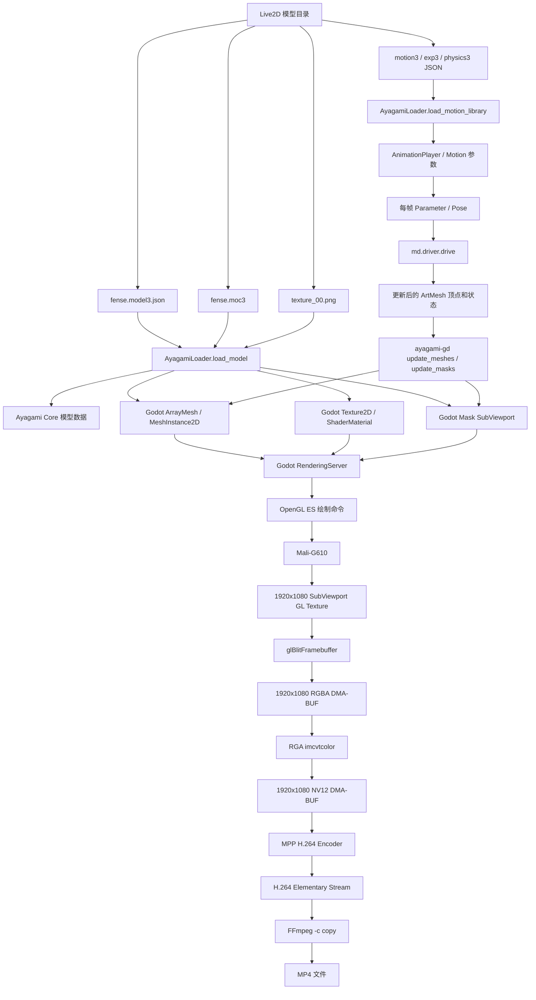

# Live2D 素材到 MP4 的完整调用与数据流程

日期：2026-10-27

## 1. 文档目的与范围

本文解释当前 RK3588 实验中，一套 Live2D 素材如何经过 Ayagami、Godot、Mali-G610、DMA-BUF、RGA 和 MPP，最终生成本地 MP4 文件。

本文描述的是已经跑通并有源码、日志和产物支持的链路：

```text
Live2D 素材
-> Ayagami 解析与逐帧模型计算
-> Godot 建立并更新渲染资源
-> Mali-G610 绘制 1920x1080 SubViewport
-> GPU 复制到 RGBA DMA-BUF
-> RGA 转换为 NV12 DMA-BUF
-> MPP 编码为 H.264
-> FFmpeg 无重编码封装为 MP4
```

当前范围不包含：

- OpenSeeFace 或其他面部识别输入；
- RKNN/NPU 推理；
- USB 摄像头和麦克风；
- UVC/UAC2 USB Gadget 输出；
- Headless EGL；
- 三缓冲、异步 fence 和产品化背压；
- 网络推流。

当前输入由 GDScript 中的固定参数变化和 `yaotou.motion3.json` 提供，输出为本地 H.264 和 MP4 文件。

## 2. 先记住四个角色

| 角色 | 当前主要语言或硬件 | 负责什么 | 不负责什么 |
|---|---|---|---|
| Ayagami Core | Rust，CPU 执行 | 解析模型逻辑，计算 Parameter、Pose、Deformer、ArtMesh 顶点和模型状态 | 不直接生成 1920x1080 像素 |
| `ayagami-gd` | Rust GDExtension，CPU 执行 | 把 Ayagami 模型转换成 Godot 节点、Mesh、材质和 Mask，并逐帧把计算结果提交给 Godot | 不执行最终 GPU 像素绘制 |
| Godot | C++ 引擎和 GDScript 调度 | 管理场景、纹理、Mesh、Shader、SubViewport、Draw Order，并生成 GPU 绘制命令 | 不代替 Ayagami 计算 Live2D 参数关系 |
| Mali-G610 | GPU | 执行顶点处理、三角形光栅化、纹理采样、Mask 采样、Shader 和透明混合 | 不解析 `model3.json`、`moc3` 或 Motion JSON |
| RGA | RK3588 2D 图形硬件 | 把 1920x1080 RGBA 转换成编码器需要的 NV12 | 不计算 Live2D 变形，不编码视频 |
| MPP/VPU | Rockchip 视频编码硬件与 API | 把 NV12 帧压缩成 H.264 packet | 不绘制人物，不读取 Live2D 模型 |
| FFmpeg | CPU 进程 | 把已有 H.264 码流封装进 MP4 容器，不重新编码 | 不参与当前人物逐帧渲染 |

一句话概括：

```text
Ayagami 决定人物怎样变形；
Godot 管理怎样绘制并指挥 GPU；
Mali-G610 生成像素；
RGA 把像素转换成视频编码格式；
MPP 把帧压缩为 H.264；
FFmpeg 给 H.264 加上 MP4 容器。
```

## 3. 总流程图



## 4. 输入素材分别是什么

当前 ZIP 中包含两个相近的模型目录，运行场景使用：

```text
/home/huangnv/open-vt-model/阿芙洛狄忒模型文件/fense_vts/fense.model3.json
```

主要文件如下：

| 文件 | 当前模型中的例子 | 谁读取或使用 | 作用 |
|---|---|---|---|
| 模型入口 | `fense.model3.json` | Ayagami Loader | 指向核心模型、纹理等资源，是加载入口 |
| 核心模型 | `fense.moc3` | Ayagami Core | 保存 Parameter、Part、Drawable/ArtMesh、顶点、UV、Deformer 和模型关系 |
| 纹理图集 | `fense.8192/texture_00.png` | `ayagami-gd` 发起加载，Godot 创建纹理，GPU 采样 | 保存脸、眼睛、嘴巴、头发、衣服等部件的颜色和透明度像素 |
| 动作 | `motions/*.motion3.json` | Ayagami Motion Loader / Godot AnimationPlayer | 保存参数随时间变化的曲线，例如摇头和眨眼 |
| 表情 | `expression/*.exp3.json` | Ayagami 表情路径 | 改变表情参数权重，例如脸红、黑脸和爱心眼 |
| 物理 | `fense.physics3.json` | Ayagami 物理路径 | 描述头发和衣物等跟随参数变化的物理响应 |
| 显示信息 | `fense.cdi3.json` | 工具和模型元数据路径 | 提供参数或部件的显示名称等信息，不直接生成像素 |
| VTube Studio 配置 | `fense.vtube.json` | VTube Studio 相关工具 | 保存跟踪映射和 Hotkey 等配置，当前渲染实验不把它作为主要驱动输入 |
| 预览图 | `ico_fense.png` | UI 或模型选择界面 | 模型缩略图，不参与人物主体渲染 |

当前模型的重要规模：

```text
Part：66
Mesh / ArtMesh：约 250
Parameter：168
主要纹理：1 张 8192x8192 PNG
Motion：6 个
Expression：5 个
运行时 Mask：8 组
依赖 Mask 的 Mesh：约 40 个
```

## 5. 为什么一张 PNG 还不能成为一个人物画面

`texture_00.png` 是纹理图集，可以把它理解为散放着人物零件的贴纸：

```text
texture_00.png

┌──────────────────────────────────┐
│ 左眼   右眼   嘴巴   脸部         │
│                                  │
│ 前发   后发   身体   衣服   饰品   │
└──────────────────────────────────┘
```

它没有直接表达：

- 左眼此刻应该放在屏幕的哪个位置；
- 眼睛闭合时轮廓怎样改变；
- 哪个三角形使用 PNG 中的哪一小块；
- 哪个部件先画，哪个部件后画；
- 眼球超出眼眶时怎样裁剪；
- 当前像素如何与后面的头发或背景进行透明混合。

这些信息需要 `moc3`、Ayagami、Godot Mesh、Shader 和 Draw Order 一起完成。

## 6. 模型加载阶段：只执行一次的主要工作

### 6.1 当前入口调用图

场景脚本：

```text
experiments/godot/openvt-dmabuf-capture/render_dmabuf_video.gd
```

启动后调用关系：

```text
Godot 启动场景
└─ render_dmabuf_video.gd::_ready()
   ├─ Engine.max_fps = 0
   ├─ RenderingServer.set_default_clear_color(...)
   ├─ ClassDB.class_exists("OpenVTDmaBufCapture")
   ├─ ClassDB.instantiate("OpenVTDmaBufCapture")
   ├─ dma_capture.configure(output_path, 1920, 1080, 30, 300)
   ├─ SubViewport.new()
   │  ├─ size = 1920x1080
   │  ├─ disable_3d = true
   │  ├─ transparent_bg = false
   │  └─ render_target_update_mode = UPDATE_ALWAYS
   ├─ AyagamiLoader.load_model(MODEL_PATH)
   ├─ render_viewport.add_child(model)
   ├─ 设置 model.scale 和 model.position
   ├─ 找到 model/MotionController
   ├─ AyagamiLoader.load_motion_library(model)
   ├─ AnimationPlayer.add_animation_library(...)
   └─ 设置默认脸部参数
```

### 6.2 `AyagamiLoader.load_model()` 内部产生两类资源

根据当前 `loader.rs` 源码检查结果，加载阶段会同时建立模型逻辑资源和 Godot 渲染资源。

逻辑资源交给 Ayagami：

```text
model3.json / moc3
-> Parameter 定义
-> Part 层级
-> Deformer 关系
-> ArtMesh 原始顶点和 UV
-> Draw Order
-> Mask 成员关系
-> 初始可见性、透明度和颜色状态
```

渲染资源交给 Godot：

```text
每个 ArtMesh
-> 创建 ArrayMesh
-> 上传初始顶点
-> 上传 UV
-> 上传三角形索引
-> 创建 MeshInstance2D
-> 绑定纹理
-> 选择并绑定 ShaderMaterial

每个 Mask Group
-> 创建 Mask SubViewport
-> 建立 Mask 源 Mesh 成员关系
-> 把 Mask 纹理绑定到依赖它的 Mesh
```

### 6.3 PNG 从磁盘到 GPU 的形态变化

```text
磁盘上的 texture_00.png
    压缩 PNG，ZIP 中单份约 28.9 MB
        ↓ 文件读取和 PNG 解码
CPU 可访问的解码像素
    8192 x 8192 x RGBA8
    理论未压缩像素约 256 MiB
        ↓ Godot / OpenGL ES 上传
GPU Texture
    Mali-G610 Shader 可以按 UV 采样
```

这张大纹理通常在模型加载时创建并重复使用。人物每一帧运动时，主要变化的是 Mesh 顶点和少量状态，不需要每帧重新读取 PNG。

### 6.4 ArrayMesh 保存什么

每个 ArtMesh 在 Godot 中对应一个可绘制的网格资源，核心数据包括：

```text
Vertex：这个零件在人物坐标中的顶点位置
UV：每个顶点对应 texture_00.png 的哪个位置
Index：哪些顶点组合成一个三角形
```

例如一个四边形可以拆成两个三角形：

```text
A────B
│  ／│
│／  │
C────D

Triangle 1：A-B-C
Triangle 2：B-D-C
```

UV 把 A、B、C、D 映射到 `texture_00.png` 中对应的眼睛、嘴巴或头发区域。Ayagami 改变顶点位置后，PNG 没有变化，零件的形状和位置发生变化，因此形成动画。

## 7. 每一帧：从参数到更新后的 Mesh

### 7.1 本实验的参数输入

当前没有摄像头或 OpenSeeFace。`render_dmabuf_video.gd::_apply_frame_animation()` 按帧号生成测试参数：

```text
1～59 帧      默认脸部参数
60～89 帧    ParamEyeLOpen / ParamEyeROpen，眨眼
90～149 帧   ParamAngleX / ParamAngleY / ParamBodyAngleX，转头和身体旋转
150～209 帧  ParamMouthOpenY / ParamMouthForm，嘴部动作
210～300 帧  AnimationPlayer 播放 yaotou.motion3.json
```

设置参数的实际入口：

```text
model.set("parameters/<ParameterId>", value)
```

### 7.2 Ayagami 每帧调用图

根据当前 `model.rs` 和性能插桩补丁，Godot 内部处理通知到来后，Ayagami 适配层执行：

```text
AyagamiModel INTERNAL_PROCESS
├─ 准备 starting_pose
├─ 应用 Parameter / Mutator
├─ apply_pose(...)
├─ clone / 保存 Pose 状态
├─ update_meshes(...)
│  ├─ md.driver.drive(m)
│  │  └─ 根据当前模型状态驱动 Deformer、ArtMesh 和相关状态
│  ├─ 遍历 self.meshes
│  ├─ 取得对应 ArtMeshState
│  ├─ 更新 visible / opacity / color 等状态
│  ├─ 检查 Mesh 是否需要更新
│  ├─ 构造 PackedVector2Array
│  ├─ PackedVector2Array.to_byte_array()
│  ├─ ArrayMesh.surface_update_vertex_region(...)
│  ├─ 计算新的 AABB
│  └─ 必要时 set_custom_aabb(...)
├─ update_masks()
│  ├─ 遍历 8 个 Mask SubViewport
│  ├─ 取得 Mask 源 Mesh 的 AABB
│  ├─ 合并 Group AABB
│  ├─ 计算 Mask dimensions / offset / scale
│  ├─ 设置 Mask SubViewport 大小与 Canvas Transform
│  └─ 向约 40 个依赖 Mesh 提交 Mask Shader 参数
└─ reorder_meshes()
   └─ 按当前 Draw Order 调整 Mesh 绘制顺序
```

### 7.3 这里 CPU 产生什么，交给 Godot 什么

```text
Ayagami Core / CPU 输出：
  每个 ArtMesh 的新顶点
  当前可见性
  当前透明度
  当前颜色状态
  当前 Draw Order

ayagami-gd / CPU 转换：
  Rust 顶点数据
  -> Godot PackedVector2Array
  -> PackedByteArray
  -> ArrayMesh 顶点区域更新

Godot 接收：
  需要更新的 Vertex Buffer 内容
  Shader 参数
  Mesh 可见性和颜色
  Mask Viewport 参数
  CanvasItem 绘制顺序
```

当前 300 帧性能测试的平均处理规模：

```text
扫描 Mesh：250.000 个/帧
更新 Mesh：206.387 个/帧
更新顶点：12575.880 个/帧
提交顶点数据：98.249 KiB/帧
```

## 8. Godot 如何把模型状态变成 GPU 命令

Godot 同时扮演资源管理器、场景调度器和渲染命令生成器。

它管理：

```text
MeshInstance2D     哪个网格参与绘制
ArrayMesh          顶点、UV 和 Index
Texture2D          角色纹理图集
ShaderMaterial     使用什么 Shader 和参数
SubViewport        绘制目标
CanvasItem 顺序    哪个部件先画、哪个部件后画
Blend Mode         当前部件怎样与已有画面混合
```

它把“画左眼”转换为 GPU 能执行的命令，概念上类似：

```text
绑定左眼 Vertex Buffer
绑定左眼 Index Buffer
绑定 texture_00.png 对应的 GPU Texture
绑定 Ayagami Shader
设置 opacity / multiply color / screen color
绑定 Mask Texture 和 Mask 参数
设置 Blend Mode
发出 Draw Call
```

当前 Ayagami 适配层为每个 ArtMesh 建立独立的 `ArrayMesh + MeshInstance2D`。Godot GLES3 Canvas Renderer 对普通 Mesh 命令逐项提交；当前源代码中 Mesh 命令不会自动合批。

## 9. Mali-G610 如何生成最终像素

### 9.1 单个 ArtMesh 的 GPU 绘制过程

```text
Godot Draw Call
    ↓
GPU 读取 Vertex / UV / Index Buffer
    ↓
顶点阶段：确定三角形在 1920x1080 画布中的位置
    ↓
光栅化：确定三角形覆盖哪些像素
    ↓
Fragment Shader：
  使用 UV 采样 texture_00.png
  读取角色颜色与 alpha
  采样 Mask Texture
  应用 multiply / screen color
  应用 opacity
    ↓
透明混合：与 SubViewport 中已经存在的像素合成
    ↓
写入 SubViewport Color Attachment
```

### 9.2 Mask 分为 CPU 准备和 GPU 执行

CPU 侧由 `ayagami-gd` 和 Godot 准备：

```text
确定哪些 ArtMesh 是 Mask 源
合并 Mask 源的 AABB
确定 Mask SubViewport 大小
设置 Mask offset / scale
把 Mask Texture 绑定给被遮罩的 Mesh
```

GPU 侧执行：

```text
先把 Mask 源 Mesh 绘制到 Mask Texture
        ↓
绘制依赖 Mesh 时采样 Mask Texture
        ↓
根据 Mask 值保留或裁剪当前像素
```

例如眼球移动时，Mask 可以限制眼球只显示在眼眶范围内。

### 9.3 最终渲染目标

当前主渲染目标是：

```text
Godot SubViewport
分辨率：1920x1080
颜色格式：当前 GLES 路径输出 RGBA 画面
更新方式：SubViewport.UPDATE_ALWAYS
```

渲染完成后，`RenderingServer.frame_post_draw` 被触发。GDScript 等待这个信号，确保当前帧已经进入渲染完成阶段，再请求捕获。

## 10. 从 SubViewport 到 RGBA DMA-BUF

### 10.1 GDScript 调用入口

```text
render_dmabuf_video.gd::_capture_frame_after_draw(frame)
├─ await RenderingServer.frame_post_draw
├─ render_viewport.get_viewport_rid()
└─ dma_capture.capture_frame(viewport_rid, frame_index, end_of_stream)
```

`OpenVTDmaBufCapture` 是加入定制 Godot 的 C++ 内置模块。

### 10.2 通过 `call_on_render_thread()` 保证图形上下文归属

```text
OpenVTDmaBufCapture::capture_frame(...)
├─ 检查配置和 Viewport RID
├─ RenderingServer::call_on_render_thread(...)
│  └─ OpenVTDmaBufCapture::_capture_frame_render_thread(...)
└─ operation_finished.wait()
```

当前产品固定使用 Safe 线程模型，Godot 所有者线程同时是 `server_thread`，所以
`call_on_render_thread()` 会直接执行 `_capture_frame_render_thread()`。如果以后切换到
Separate 模式，这个调用才会把任务放入 Godot 渲染命令队列，由独立 Render Thread
执行。

`capture_frame()` 会等待纹理复制、`glFinish()` 和 READY slot 发布完成。RGA/MPP 由
`OpenVT RGA MPP` 媒体线程异步消费 READY slot，RTSP 写出再由 `OutputManager` 工作线程
处理；调用方不会同步等待这两个阶段完成。

### 10.3 图形上下文所属线程取得 SubViewport 原生纹理

```text
_capture_frame_render_thread(viewport_rid, ...)
├─ RenderingServer::viewport_get_texture(viewport_rid)
│  └─ 得到 Godot render-target Texture RID
├─ RenderingServer::texture_get_native_handle(texture, false)
│  └─ 得到 OpenGL ES GLuint Texture Handle
└─ OpenVTDmaBufPipeline::capture(gl_texture, ...)
```

这里取得的是 GPU 纹理句柄，没有调用：

```text
SubViewport.get_texture().get_image()
glReadPixels()
CPU 原始 RGBA 缓冲
CPU 像素 memcpy
```

### 10.4 第一次捕获时初始化 DMA-BUF 资源

`OpenVTDmaBufPipeline::initialize()` 首次执行：

```text
计算布局
├─ rgba_stride = 1920 * 4 = 7680 bytes
├─ nv12_stride = 1920 bytes
└─ nv12_vertical_stride = align_up(1080, 16) = 1088

从 /dev/dma_heap/system-uncached 分配
├─ RGBA DMA-BUF
│  └─ 7680 * 1080 = 8,294,400 bytes
└─ NV12 DMA-BUF
   └─ 1920 * 1088 * 3 / 2 = 3,133,440 bytes

建立 GPU 目标
├─ eglCreateImageKHR(RGBA DMA-BUF fd)
├─ glEGLImageTargetTexture2DOES(...)
├─ 创建 GL Texture
└─ 把 Texture 挂到输出 Framebuffer

建立 RGA 资源
├─ importbuffer_fd(RGBA fd)
├─ importbuffer_fd(NV12 fd)
└─ wrapbuffer_handle_t(...)

建立 MPP 资源
├─ mpp_create(...)
├─ mpp_init(..., MPP_CTX_ENC, MPP_VIDEO_CodingAVC)
├─ 设置 1920x1080 / NV12 / 30 FPS / CBR / GOP 等参数
├─ mpp_buffer_import(NV12 DMA-BUF fd)
└─ 打开 H.264 输出文件
```

### 10.5 每帧 GPU copy

```text
OpenVTDmaBufPipeline::capture(source_texture, ...)
├─ glBindFramebuffer(GL_READ_FRAMEBUFFER, source_framebuffer)
├─ glFramebufferTexture2D(..., source_texture)
│  └─ 把 Godot SubViewport Texture 作为读取源
├─ glBindFramebuffer(GL_DRAW_FRAMEBUFFER, dma_target_framebuffer)
│  └─ 把 RGBA DMA-BUF 对应的 EGLImage Texture 作为写入目标
├─ glBlitFramebuffer(..., GL_COLOR_BUFFER_BIT, GL_NEAREST)
│  └─ Mali-G610 在 GPU 内部复制完整 1920x1080 RGBA 帧
├─ glFinish()
│  └─ CPU 等待 GPU copy 完成
└─ 恢复之前的 OpenGL 状态
```

当前路径仍存在一次 GPU 纹理复制：

```text
Godot SubViewport GL Texture
        ↓ glBlitFramebuffer
外部 RGBA DMA-BUF 对应的 GL Texture
```

它避免了 GPU 到 CPU 的原始像素读回，但仍然搬运一次 GPU 图像数据。

## 11. RGA：RGBA 转换为 NV12

MPP H.264 编码器需要 NV12 输入。Godot 产生的是 RGBA 画面，因此使用 RGA 完成颜色格式转换：

```text
RgaConverter::convert()
└─ imcvtcolor_t(
      source = RGBA DMA-BUF,
      destination = NV12 DMA-BUF,
      source_format = RK_FORMAT_RGBA_8888,
      destination_format = RK_FORMAT_YCbCr_420_SP,
      color_space = BT.601 Limited
   )
```

数据变化：

```text
RGBA8888
每个像素约 4 bytes
适合 GPU 绘制和颜色混合
        ↓ RGA
NV12 / YUV420SP
亮度 Y 平面 + 交错 UV 平面
平均每个像素约 1.5 bytes
适合视频编码器输入
```

RGA 直接导入两块 DMA-BUF 的 fd。CPU 负责发起任务和等待结果，不读取或逐像素转换整张画面。

## 12. MPP：NV12 压缩为 H.264

### 12.1 初始化

当前 `MppEncoder::initialize()` 设置：

```text
编码类型：H.264 / AVC
输入格式：MPP_FMT_YUV420SP，也就是 NV12
分辨率：1920x1080
输入和输出帧率：30/1
码率模式：CBR
目标码率：8,000,000 bit/s
最大码率：8,500,000 bit/s
最小码率：7,500,000 bit/s
GOP：60 帧
H.264 Profile：100
H.264 Level：40
NV12 输入：通过 MPP_BUFFER_TYPE_EXT_DMA 导入 DMA-BUF fd
```

### 12.2 每帧编码调用图

```text
MppEncoder::encode_frame(frame_index, end_of_stream)
├─ mpp_frame_set_pts(frame, frame_index * 1,000,000 / fps)
├─ mpp_frame_set_eos(frame, ...)
├─ MppApi::encode_put_frame(context, frame)
│  └─ MPP/VPU 读取同一块 NV12 DMA-BUF
├─ MppApi::encode_get_packet(context, &packet)
│  └─ 取得压缩后的 H.264 packet
├─ mpp_packet_get_pos(packet)
├─ mpp_packet_get_length(packet)
├─ FileAccess::store_buffer(packet_bytes, length)
│  └─ 把压缩数据写入 .h264 文件
└─ mpp_packet_deinit(&packet)
```

零拷贝边界需要准确理解：

```text
NV12 原始像素：RGA 输出 DMA-BUF 被 MPP 直接导入，没有 CPU 原始像素复制。
H.264 压缩数据：MPP 返回 packet，CPU 调用 FileAccess 把压缩字节写入磁盘文件。
```

## 13. 从 H.264 码流封装成 MP4

Godot 进程退出后，运行脚本执行：

```bash
ffmpeg -framerate 30 -i openvt-ayagami-dmabuf-1920x1080-30fps.h264 \
  -c copy openvt-ayagami-dmabuf-1920x1080-30fps.mp4
```

这里的 `-c copy` 表示：

```text
H.264 压缩帧保持原样
        ↓
增加 MP4 容器结构、时间信息和索引
        ↓
生成播放器容易识别和跳转的 .mp4 文件
```

FFmpeg 此处没有把视频解码后重新编码，因此不会再次处理 1920x1080 原始像素。

脚本随后执行：

```text
ffprobe
-> 确认 codec、分辨率、像素格式、时长和帧数

ffmpeg -i output.mp4 -f null -
-> 完整解码检查，确认码流没有解码错误

按多个时间点抽取 PNG
-> 比较画面方向、颜色和动作

sha256sum
-> 记录产物和日志哈希
```

## 14. 一帧的完整时序调用图

```text
Godot Main Thread / GDScript
│
├─ render_dmabuf_video.gd::_process()
│  ├─ _apply_frame_animation(frame)
│  ├─ 必要时 _start_shake_motion()
│  └─ _capture_frame_after_draw(frame)
│
├─ AyagamiModel INTERNAL_PROCESS
│  ├─ Parameter / Pose / Mutator
│  ├─ md.driver.drive(m)
│  ├─ update_meshes()
│  ├─ update_masks()
│  └─ reorder_meshes()
│
├─ Godot 收集 CanvasItem / Mesh / Material 状态
│
└─ 等待 RenderingServer.frame_post_draw
                     │
                     ▼
Godot Render Thread
│
├─ RenderingServer / GLES3 生成并提交 Draw Call
│                      │
│                      ▼
│                 Mali-G610 GPU
│                 ├─ 读取 Mesh Buffer
│                 ├─ 采样 texture_00.png
│                 ├─ 绘制和采样 Mask
│                 ├─ 透明混合
│                 └─ 写入 SubViewport Texture
│
├─ viewport_get_texture(viewport_rid)
├─ texture_get_native_handle(texture)
├─ glBlitFramebuffer(SubViewport -> RGBA DMA-BUF)
├─ glFinish()
├─ RGA imcvtcolor(RGBA DMA-BUF -> NV12 DMA-BUF)
├─ MPP encode_put_frame(NV12 DMA-BUF)
├─ MPP encode_get_packet()
├─ FileAccess::store_buffer(H.264 packet)
└─ operation_finished.post()
                     │
                     ▼
Godot Main Thread
│
├─ capture_frame() 返回
├─ frame_index++
└─ 开始下一帧
```

当前时序的重要特点：

- `capture_frame()` 会等待 Render Thread 完成；
- `glFinish()` 会等待 GPU copy 完成；
- RGA 转换完成后才调用 MPP；
- MPP 取得并写完当前 packet 后才返回；
- 当前只有一组 RGBA/NV12 DMA-BUF；
- 因此当前是一帧接一帧的同步正确性实现。

## 15. 数据格式、位置和所有者变化

| 阶段 | 数据形态 | 主要位置 | 主要所有者或接口 | 每帧变化 |
|---|---|---|---|---|
| 模型入口 | JSON 文本 | 磁盘/CPU 内存 | Ayagami Loader | 加载时读取 |
| 核心模型 | `moc3` 二进制和解析结构 | 磁盘/CPU 内存 | Ayagami Core | 结构通常固定，状态每帧变化 |
| 纹理文件 | PNG 压缩数据 | 磁盘 | 模型资源目录 | 通常固定 |
| 解码纹理 | RGBA 像素 | CPU 内存，随后上传 | Godot 图像加载路径 | 加载时产生 |
| GPU 纹理 | Texture2D | GPU 显存 | Godot RenderingServer / Mali | 通常固定并被重复采样 |
| 模型顶点 | Rust 数组 | CPU 内存 | Ayagami Core | 每帧可能变化 |
| Godot 顶点 | PackedVector2Array / ArrayMesh | CPU 到 GPU Buffer | `ayagami-gd` / Godot | 当前约 98.249 KiB/帧提交 |
| Mask 参数 | AABB、offset、scale | CPU 内存与 Shader 参数 | `ayagami-gd` / Godot | 当前每帧更新 |
| 最终画面 | 1920x1080 RGBA Texture | GPU 显存 | Godot SubViewport / Mali | 每帧产生 |
| 捕获画面 | 1920x1080 RGBA | DMA-BUF | GPU/EGLImage/RGA 共享 | 每帧被 GPU copy 覆盖 |
| 编码输入 | 1920x1080 NV12 | DMA-BUF | RGA/MPP 共享 | 每帧被 RGA 覆盖 |
| 编码输出 | H.264 packet | MPP packet/CPU 可访问压缩数据 | MPP + FileAccess | 每帧产生并写盘 |
| 视频容器 | MP4 | 磁盘 | FFmpeg | 全部 H.264 完成后封装 |

## 16. 当前链路中实际发生的复制与同步

| 位置 | 是否发生数据传递 | 当前性质 |
|---|---|---|
| PNG 文件到 CPU 解码图像 | 有 | 模型加载时的文件读取和解码 |
| CPU 解码图像到 GPU Texture | 有 | 模型加载时的纹理上传，通常一次 |
| Ayagami 顶点到 Godot PackedArray | 有构造和转换 | CPU 数据转换 |
| Godot 顶点更新到 GPU Buffer | 有 | 当前平均约 98.249 KiB/帧 |
| GPU 绘制到 SubViewport | GPU 渲染写入 | 正常绘制过程 |
| SubViewport Texture 到 RGBA DMA-BUF | 有 | `glBlitFramebuffer`，GPU 内部完整帧复制 |
| RGBA DMA-BUF 到 CPU 原始像素 | 无 | 当前没有 `get_image()` 或 `glReadPixels()` |
| RGBA DMA-BUF 到 NV12 DMA-BUF | 有 | RGA 读取一块 DMA-BUF 并写入另一块，同时转换格式 |
| NV12 DMA-BUF 到 MPP 输入 | 共享同一 fd | MPP 直接导入，没有 CPU 原始像素 memcpy |
| MPP packet 到 H.264 文件 | 有 | CPU 写入已经压缩的数据，数据量远小于原始 RGBA |
| H.264 到 MP4 | 容器重写 | `-c copy`，无视频重编码 |

## 17. 当前实测时间对应到哪里

性能插桩版本的 300 帧平均值：

```text
GDScript 动画参数处理                  0.647 ms
等待 frame_post_draw                   16.516 ms
  其中 Ayagami 内部更新                 7.752 ms
    Mesh 更新                           6.643 ms
      md.driver.drive(m)                约 2.35 ms
    Mask 更新                           0.577 ms
捕获函数整体                            7.344 ms
  GPU glBlitFramebuffer                 1.070 ms
  RGA RGBA -> NV12                      2.254 ms
  MPP H.264                             3.977 ms
```

正确性版本的独立实机结果：

```text
1920x1080，30 FPS，300 帧
媒体时长：9.9999 秒
核心链路吞吐：39.264 FPS
GPU copy：1.244 ms/帧
RGA：2.109 ms/帧
MPP：3.956 ms/帧
最终 H.264 编码数据：8,595,163 bytes
```

`frame_post_draw` 等待时间包含 Ayagami CPU 更新、Godot 渲染调度、Render Thread、驱动和 GPU 渲染等工作，不能把剩余时间全部归因于某一个组件。

## 18. 当前实现的资源生命周期

### 18.1 启动时

```text
加载 Godot 与 ayagami-gd
-> 加载 Live2D 模型
-> 创建 250 个 Mesh 对应的渲染对象
-> 加载并上传大纹理
-> 创建 Mask SubViewport
-> 创建主 1920x1080 SubViewport
-> 准备 Motion Library
```

### 18.2 第一次捕获时

```text
分配 RGBA DMA-BUF
-> 分配 NV12 DMA-BUF
-> 创建 EGLImage / GL Texture / Framebuffer
-> RGA 导入两个 DMA-BUF fd
-> MPP 导入 NV12 fd
-> 打开 H.264 文件
```

### 18.3 每帧

```text
更新参数
-> Ayagami 计算模型
-> Godot 更新资源并渲染
-> GPU copy
-> RGA 转换
-> MPP 编码
-> 写入 H.264 packet
```

### 18.4 收尾时

```text
dma_capture.finish()
-> Render Thread 删除 OpenVTDmaBufPipeline
-> 释放 MPP Frame / Buffer / Context
-> 释放 RGA Handle
-> 删除 GL Framebuffer / Texture / EGLImage
-> 关闭 DMA-BUF fd
-> 关闭 H.264 文件
-> Godot 退出
-> FFmpeg 封装 MP4
-> ffprobe 与完整解码验证
```

## 19. 当前已经验证和仍未完成的边界

已经验证：

- Ayagami 可以加载当前 `model3/moc3/PNG`；
- Godot 定制混合模式和 Mali-G610 GLES3 路径可以绘制人物；
- 1920x1080 SubViewport 输出方向和颜色正确；
- GPU Texture 可以通过 `glBlitFramebuffer` 写入外部 RGBA DMA-BUF；
- RGA 可以把 RGBA DMA-BUF 转换为 NV12 DMA-BUF；
- MPP 可以直接导入 NV12 DMA-BUF 并编码 H.264；
- 300 帧输出可以封装为 MP4；
- `ffprobe` 帧数正确，FFmpeg 完整解码无错误；
- 抽帧确认眨眼、转头、嘴部和摇头动作发生变化。

当前仍有这些产品化边界：

- Godot 仍通过 X11 获得 EGL Context；
- 使用一组 RGBA/NV12 DMA-BUF；
- GPU copy 后使用 `glFinish()` 全局等待；
- GDScript 主线程同步等待 Render Thread 完成捕获；
- RGA 和 MPP 依次同步执行；
- 尚未接入三缓冲和显式 fence；
- 尚未实现队列、背压、丢帧策略和异常恢复；
- 尚未接入 OpenSeeFace、RKNN、摄像头、音频或 UVC；
- 当前 MP4 在 Godot 退出后由 FFmpeg 单独封装。

## 20. 源码与证据索引

当前场景和每帧调度：

```text
experiments/godot/openvt-dmabuf-capture/render_dmabuf_video.gd
experiments/godot/openvt-dmabuf-capture/render_dmabuf_video.tscn
```

Godot 内置 DMA-BUF/RGA/MPP 模块：

```text
experiments/godot/openvt-dmabuf-capture/module/openvt_dmabuf_capture/openvt_dmabuf_capture.cpp
experiments/godot/openvt-dmabuf-capture/module/openvt_dmabuf_capture/openvt_dmabuf_capture.h
experiments/godot/openvt-dmabuf-capture/module/openvt_dmabuf_capture/register_types.cpp
```

运行和 MP4 封装脚本：

```text
experiments/godot/openvt-dmabuf-capture/run_render_on_rk.sh
```

实验说明：

```text
experiments/godot/openvt-dmabuf-capture/README.md
docs/openvt-rk3588-godot-ayagami-experiment-record-2026-10-27.md
docs/headless-live2d-uvc-implementation-plan.md
docs/live2d-rendering-optimization-backlog.md
```

Ayagami 性能插桩证据：

```text
build/remote-artifacts/ayagami-profile-20261027-01/ayagami-profile-instrumentation-v3.patch
build/remote-artifacts/ayagami-profile-20261027-01/run-v3/godot-render.log
```

正确性运行产物：

```text
build/remote-artifacts/openvt-godot-dmabuf-20261027/run-03/
  openvt-ayagami-dmabuf-1920x1080-30fps.mp4
  godot-render.log
  ffprobe.txt
  decode.log
  preview-contact-sheet.jpg
```

最终 MP4 SHA-256：

```text
29d43d436c0d084df16a356ccb8bc4890ca6c66a1e53180305266ee059bba7a4
```

## 21. 最短总结

```text
1. Ayagami 读取模型逻辑，计算每帧人物怎样变形。
2. ayagami-gd 把结果转换成 Godot Mesh、材质和 Mask 参数。
3. Godot 管理资源、绘制顺序和 Shader，并向 Mali-G610 提交 Draw Call。
4. Mali-G610 采样人物纹理、处理 Mask 和透明混合，生成 SubViewport RGBA 画面。
5. GPU 把 SubViewport 复制到 RGBA DMA-BUF。
6. RGA 把 RGBA DMA-BUF 转换为 NV12 DMA-BUF。
7. MPP 直接读取 NV12 DMA-BUF，编码为 H.264 packet。
8. CPU 把压缩 packet 写入 .h264 文件。
9. FFmpeg 不重新编码，只把 H.264 封装成 MP4。
```
