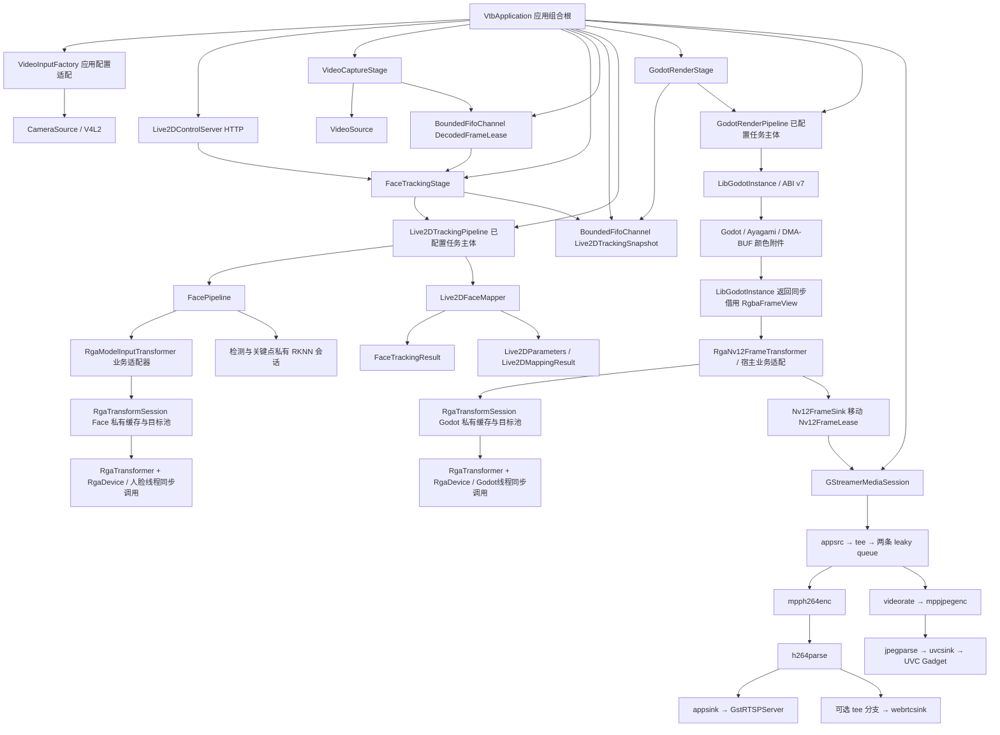

# Live2D 产品模块边界

2026-11-03：本轮调整模块依赖、职责与接口语义。安全审查、音频链路和硬件缓冲策略不在本轮范围。

## 为什么调整

原有 FaceTrackingService 同时包含算法装配、Live2D 映射、产品状态和 HTTP；视频工厂依赖
完整应用配置；渲染头文件通过值类型引入 mapper；通用会话受 RKNN/OpenCV 构建开关控制；
Godot 模块内部选择 RTSP 并持有 OutputManager。这些关系会扩大修改与编译范围。

本次把产品选择集中到 `apps/vtb-live2d`，低层算法与后端只保留自己的输入输出契约。
更小的做法是只移动文件，但仍会保留头文件传递依赖、硬件构建条件和 Godot 的 FFmpeg
链接依赖，因此同时调整这些实际边界。LibGodot 当前把 RGBA DMA-BUF 设为 Viewport
颜色附件，负责直接渲染、GPU 完成等待和同步交付；宿主 `RgaNv12FrameTransformer`
完成 RGBA→NV12。2026-11-16
起，`GStreamerMediaSession` 取得 NV12 槽位租约，并用 GStreamer 的 tee、流线程和有界
leaky queue 管理 H.264 网络与 MJPEG UVC 两个分支；Rockchip GStreamer 插件直接调用
MPP 编码器。Face 与 Godot 的私有 `RgaTransformSession` 分别在所属业务线程直接同步
调用 librga，RGA 与 MPP 硬件核心由 RK3588 驱动选择。

## 当前依赖



箭头表示依赖或装配关系。`GodotRenderPipeline` 的 LibGodot 边界在同步交付 RGBA 后
结束，宿主调用栈继续进入 `RgaNv12FrameTransformer`。转换后的 `Nv12FrameLease` 被移动
到 DMA-BUF `GstMemory`；最后一个内存引用释放后才归还 RGA 槽位。两个 Rockchip
GStreamer 编码元件分别拥有 H.264 与 MJPEG 的 MPP 上下文。

| 位置 / 目标 | 责任与依赖限制 |
| --- | --- |
| `include/vtb/messaging`、`src/messaging` | 通用线程间通道、视频帧消息契约与跨阶段所有权交接类型；通道不创建线程，也不依赖具体生产者或消费者 |
| `include/vtb/video`、`vtb_video_core` | 视频来源、同步消费者和源生命周期控制协议；不依赖 face、live2d、应用配置 |
| `vtb_capture` | V4L2 设备和缓冲区；只接收 `CaptureConfig` |
| `vtb_face_core` | 通用算法接口、流程与 FaceFrameConsumer；不包含 HTTP 或 Live2D 类型 |
| `include/vtb/hardware/rga`、`src/hardware/rga` | Face/Godot 的业务适配器各自持有 `RgaTransformSession`、`RgaTransformer`、`RgaDevice`、源注册缓存和目标池，并在所属业务线程同步调用 librga |
| `include/vtb/hardware/rknn`、`src/hardware/rknn` | RKNN 人脸模型实现；检测与关键点对象各自独占 model、context、输入绑定和输出缓冲 |
| `vtb_live2d_values` | 参数与映射结果值类型；没有 face 或推理依赖 |
| `vtb_live2d_mapper` | 人脸结果到 Live2D 的校准、映射和平滑 |
| `vtb_live2d_stages` | 视频采集、人脸处理两个独立工作阶段及同步跟踪主体；Stage 拥有线程，主体拥有算法，通道完成数据交接 |
| `apps/vtb-live2d/libgodot_instance.*` | 独占 Godot 参数拼装、LibGodot/OpenVT ABI 检查与调用、Live2D 参数提交和实例清理；不包含 Pipeline 计时、RGA 或 NV12 输出逻辑 |
| `vtb-live2d` 内的 Godot pipeline 源码 | `GodotRenderPipeline` 编排并分别计时参数准备、iteration、GPU render wait、RGBA 交付和宿主 RGA；`GodotRenderStage` 绑定跟踪通道并拥有 Godot 所有者线程；Pipeline 不包含 LibGodot ABI 实现 |
| `vtb_rga_core` | 提供通用转换请求、Session、租约、目标池、同步执行端和两个具体业务 Transformer；不创建线程或任务队列 |
| `vtb_gstreamer_media_session` | 把 NV12 DMA-BUF Lease 绑定到 `GstMemory`，建立编码 pipeline、进程内 GstRTSPServer、可选 WebRTC 及 UVC 输出 |
| `vtb_live2d_control` | HTTP 解析与 JSON 状态序列化；借用 FaceTrackingStage 的查询、取景、校准能力 |
| `vtb_application_video_input` | 应用配置转换为后端配置并选择摄像头实现 |
| LibGodot 模块 | 把外部 RGBA DMA-BUF texture 设为 Viewport RenderTarget 颜色附件，执行直接渲染、`glFinish` 和 RGBA 同步交付；不编译 RGA、MPP、GStreamer、指标报告器或网络/UVC 输出 |

`vtb_render_runtime` 保留为带替身后端的生命周期契约原型，仅由既有状态机单元测试使用。
产品渲染生命周期由 `apps/vtb-live2d/pipeline` 中的 `GodotRenderStage` 与
`GodotRenderPipeline` 协作管理。Stage 负责线程、通道与调度；Pipeline 在该所有者线程中
创建并独占 `LibGodotInstance`。只有 `libgodot_instance.cpp` 包含 LibGodot 与 OpenVT
桥接头文件，Pipeline 通过独立宿主类的公开接口编排实例。
原型渲染头文件现在直接依赖参数值类型。

`VtbApplication` 是流水线的组合根，直接拥有两条容量一通道和三个 Stage。通道只提供
存储、同步、关闭与所有权移动；工作线程分别属于 `VideoCaptureStage`、
`FaceTrackingStage` 和 `GodotRenderStage`。
`FacePipeline::create()` 使用配置中的 DMA heap 装配具体模型输入 Transformer、两个 RKNN
模型和几何估计器；Application 将创建
完成的 FacePipeline 与映射配置交给 `Live2DTrackingPipeline` 构造函数。任务主体只提供同步处理，
它不创建线程也不持有通道。`FaceTrackingStage` 因而只连接任务主体、输入通道和输出通道。
`GodotRenderPipeline::create()` 同样只装配配置与输出依赖；`GodotRenderStage` 取得其独占
所有权并绑定跟踪通道。Stage 工作线程在首次 Godot 调用前接管 Pipeline，使 LibGodot 的
创建、逐帧驱动、输出排空与销毁保持在同一个 OS 线程。
`FacePipeline` 的产品创建、构造、逐帧处理和源代次清理统一实现在
`src/face/face_pipeline.cpp`，产品创建入口始终参与编译。CMake 的 `vtb_face_pipeline`
目标在三种产品后端都启用时链接具体硬件依赖；产品配置默认具备这些后端。

`RgaModelInputTransformer` 直接持有 Face 私有 `RgaTransformSession`。Session 保存源代次、
`RgaBuffer` 注册缓存和同步 `RgaTransformer`，并持有独立 `RgaBufferPool` 管理 RGB888
DMA-BUF 槽位；直接调用 librga 期间调用栈继续持有上游帧租约。RKNN 模型
保持在 detector/landmark 内部：每个模型的 context、core 选择和张量属性与模型文件强绑定，
当前没有跨流水线共享 context。`mpph264enc` 与 `mppjpegenc` 分别管理自己的 MPP
context，避免把码控、GOP、PTS/DTS 与输入 DMA-BUF 绑定混成全局状态；应用层不再直接
包含 MPP API 或输入导入缓存。

Live2D 的 `RgaNv12FrameTransformer` 位于宿主，接收 ABI v7 的 `RgbaFrameView`。它通过
自己的 `RgaTransformSession` 缓存 RGBA DMA-BUF 导入，并由独立 `RgaBufferPool` 管理
四槽 NV12 输出缓冲；Session 在 Godot 所有者线程同步调用 librga。Pipeline 取得同步
借用视图后等待 RGA 调用返回，再把
`Nv12FrameLease` 移动给媒体 Sink。GStreamer 最后一个缓冲引用释放时，槽位才重新进入
RGA 目标池。Face 和 Godot 的 Session 不共享源 handle、目标槽位或用户态执行对象。

本次归位解决的是维护边界。更小的方案是把 Application 中的自由工厂函数原样移动到另一个
文件，但调用方仍会依赖具体硬件类型。当前方案把具体业务 Transformer 放到对应 Pipeline，
并让每个 Session 独占同步 RGA 执行对象。该重构建立明确的资源和并发边界；是否带来吞吐
或延迟收益仍需 RK3588 指标验证。

`messaging/video` 是共享的视频帧消息契约：格式枚举、`FramePlaneView` 和 `FrameView`
描述消息数据，其中地址和 DMA-BUF fd 都是借用入口；`DecodedFrameLease` 为同一条消息
承担跨阶段的独占归还责任。`BoundedFifoChannel<T>` 只负责存储、同步和移动消息所有权。
该目录定义把“消息长什么样”“控制权由谁持有”和“怎样传输”集中展示，同时保持三项
职责由不同类型承担。目录调整不改变帧复制次数、线程数量或运行时性能。

## 当前渲染与输出线程

产品启动参数显式固定 `--render-thread safe`，资源工程也固定
`rendering/driver/threads/thread_model=1`。在该模式下，Godot 所有者线程同时是 Godot
主线程和 `RenderingServer` 执行线程。`call_on_render_thread()` 检测到调用者就是
`server_thread` 后会直接执行捕获回调。
这里的“同一线程”指同一个 OS thread ID；Linux 调度器仍可让该线程在不同 CPU core
之间迁移，当前实现没有做 CPU 亲和性绑定。

```text
Godot 所有者兼渲染执行线程
  prepare_frame → iteration → RenderingServer draw
  → Viewport RenderTarget 直接写 RGBA DMA-BUF
  → wait_gpu_render / glFinish
  → LibGodotInstance::publish_rgba_frame → 返回同步借用 RgbaFrameView
  → 宿主 RgaNv12FrameTransformer → Godot RgaTransformSession
  → Godot 所有者线程直接调用 RgaTransformer/RgaDevice
  → Nv12FrameSink::submit（把 Lease 移动到 DMA-BUF GstMemory）
  → GStreamer raw appsrc → tee
                            │
                 ┌──────────┴───────────┐
                 ▼                      ▼
GStreamer H.264 分支流线程              GStreamer MJPEG 分支流线程
  leaky queue → mpph264enc                leaky queue → videorate
  → h264parse                              → mppjpegenc → jpegparse
  → appsink → GstRTSPServer                → uvcsink → /dev/video2
  → 每客户端 appsrc → rtph264pay → RTSP/TCP
```

这里列出的是 Live2D 所有者线程与两个 GStreamer 分支流线程；摄像头采集、人脸消费、
控制、指标以及 Godot 内部工作池仍有各自线程。GPU 作为独立硬件执行图形命令；
`glFinish()` 是所有者线程等待本次 DMA-BUF 渲染完成的同步点。Godot 与 Face 可从各自
线程并发调用 librga；两个 GStreamer MPP 编码元件分别在对应分支流线程执行。

`call_on_render_thread()` 保留对 Separate 模式的正确路由能力。以后显式切换 Separate 时，
Godot 会创建 RenderingServer 线程，捕获回调通过命令队列转交；该模式需要重新进行完整
实机验收，不属于当前产品配置。

## 快照与帧租约语义

- Godot 所有者线程直接调用 `tracking_channel_.try_pop()` 非阻塞读取。
  取得快照时先执行 `submit()` 再渲染本帧；通道暂无快照时保持 Godot 内的最近参数。
  通道已 `finished()` 且队列已排空时直接退出循环，该周期不调用 `run_frame()`。
  跟踪有效性由 `mapping().tracking_valid()` 描述。
- `snapshot_generation` 随映射结果或取景状态更新递增；映射的 `frame_id()` 对应来源帧。
- `produced_timestamp_ns` 由项目级 `MonotonicClock` 产生，属于 Linux
  `CLOCK_MONOTONIC` 纳秒时间轴。取景更新保留这个时间，
  不能让过期的映射重新变新。
- Godot 没有收到新快照时保持最近参数；超过 150 ms 后以 250 ms 时间常数衰减到默认值。
  取景更新独立应用，过期快照不能把已经衰减的参数重置回旧值。
- `VideoFrameConsumer::consume()` 必须在返回前完成处理并释放租约。控制线程通过
  `VideoStreamControlProtocol` 在采集前确认 `begin_source`，在最后一帧后确认
  `retire_source`；消费者仍不能把租约或帧内存指针保存到返回之后。
- 可选人脸诊断只复制 `FaceTrackingResult`，后台槽位容量为一。它没有把
  `DecodedFrameLease` 变成多消费者总线，也不会让诊断编码背压延长 V4L2 租约。

## RGBA、NV12、编码包交接与关闭顺序

底层 ABI 仍通过 `RgbaFrameSink` 同步提交 fd、缓冲区大小、宽高、stride、帧率、时间戳、
序号和 stream generation；回调目标收敛在 `LibGodotInstance` 内部。该宿主类复制帧描述后
返回 `RgbaFrameView`，Pipeline 同步等待 RGA 完成，然后通过 `Nv12FrameSink` 把
`Nv12FrameLease` 移动给 `GStreamerMediaSession`。媒体会话复制 DMA-BUF fd，并把 Lease
绑定到对应的 `GstMemory`。tee 与两个分支通过缓冲和内存引用计数表达共享读取；
输入布局匹配时，两路 MPP 编码器直接导入同一块 NV12 DMA-BUF。最后一个输入内存引用
释放后，Lease 才归还 RGA 槽位。H.264 编码包经 parser 进入 appsink，再以 GStreamer
buffer 浅拷贝分发给客户端 RTP pipeline；应用不解析或复制编码字节。

宿主先构造输出接收器，再启动 Godot 所有者线程，使异常展开时接收器仍有效。正常关闭顺序：

1. 停止 HTTP、视频采集与人脸跟踪，确保不再发布新输入。
2. `GodotRenderStage::finish()` 停止渲染生产并销毁 LibGodot；RGA Transformer 等待其
   目标池租约归还后退休资源。
3. `GStreamerMediaSession::finish()` 停止接收 RTSP 客户端，向 raw appsrc 发送 EOS，
   等待两个编码分支和输出端消费在途帧。
4. pipeline 进入 NULL，释放全部 `GstBuffer`、`GstMemory`、NV12 Lease 和两个编码元件，
   随后关闭指标报告器。

应用保存运行或清理阶段出现的第一次异常，在以上步骤全部执行后重新抛出。

渲染/GPU、RGA、编码和 GStreamer 提交指标均由宿主持有；退出时
`VTB_GSTREAMER_MEDIA_RESULT` 报告提交、两路编码、raw queue 丢帧以及周期性/下游触发的
IDR 请求计数。
编码完成与网络或 USB 主机实际消费仍是不同的验收层级。

## 配置与构建兼容性

- `output.rtsp_url` 配置进程内 RTSP Server 的监听地址、端口和挂载点；可选的 `output.uvc` 配置 Gadget V4L2 节点、
  GStreamer 1.28.9 插件目录和 MJPEG 帧率。
- 桥接使用 `openvt_libgodot_application_initialize_v7()`，启动检查 ABI 版本和配置尺寸；
  宿主与 LibGodot 必须成对构建、成对部署，不能混用历史二进制。
- Godot 模块只要求 `OPENVT_VTB_SOURCE_ROOT` 与 `OPENVT_BOARD_SYSROOT`，不链接 RGA、
  MPP 或 GStreamer。宿主产品目标链接 Rockchip RGA 与 GStreamer 1.28.9；MPP 动态依赖
  由 `libgstrockchipmpp.so` 引入。
- `VTB_ENABLE_RGA_FACE`、`VTB_ENABLE_RKNN_FACE` 和
  `VTB_ENABLE_OPENCV_FACE_PIPELINE` 当前默认为 `ON`。产品还需要 RTSP 和
  embedded Godot 开关；通用组件不受这些开关限制。
- 历史 `render_dmabuf_video.gd` 场景须搭配 ABI v2 之前的完整二进制。当前模块不再提供
  GDScript 的 RTSP configure 入口，脚本检测后给出明确迁移提示。

## 验证范围

2026-11-17 已完成 ARM64 产品编译、RK3588 部署、双 MPP 持续运行、进程内 RTSP 首连、
重连、双客户端与 ffmpeg 解码验证。板端 UDC 已 configured，uvc.usb0 与 MJPEG 输出分支持续工作；本轮
USB 主机是当前无法通过公网隧道登录的树莓派，Mac 未直接连接 OTG，因此主机侧实际 UVC
抓帧仍待重新验收。详细分层结论见 ADR 0005。
