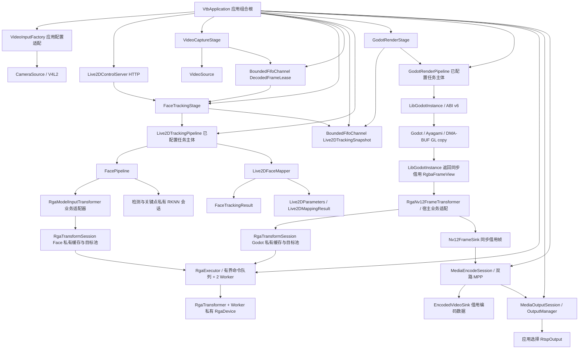

# Live2D 产品模块边界

2026-11-03：本轮调整模块依赖、职责与接口语义。安全审查、音频链路和硬件缓冲策略不在本轮范围。

## 为什么调整

原有 FaceTrackingService 同时包含算法装配、Live2D 映射、产品状态和 HTTP；视频工厂依赖
完整应用配置；渲染头文件通过值类型引入 mapper；通用会话受 RKNN/OpenCV 构建开关控制；
Godot 模块内部选择 RTSP 并持有 OutputManager。这些关系会扩大修改与编译范围。

本次把产品选择集中到 `apps/vtb-live2d`，低层算法与后端只保留自己的输入输出契约。
更小的做法是只移动文件，但仍会保留头文件传递依赖、硬件构建条件和 Godot 的 FFmpeg
链接依赖，因此同时调整这些实际边界。2026-11-14 先将隐藏的媒体线程合回 Godot
所有者线程，随后把 RGA 和 MPP 都移到宿主。LibGodot 当前只负责渲染、GPU 拷贝、GPU
完成等待和 RGBA DMA-BUF 交付；宿主 `RgaNv12FrameTransformer` 完成 RGBA→NV12，
`MediaEncodeSession` 完成双路编码。Face 与 Godot 各自同步提交任务并等待结果；共享
`RgaExecutor` 使用容量四的 FIFO 和两个 Worker 执行 RGA 命令，Worker 不固定 RGA 核心，
由 RK3588 驱动选择兼容核心。OutputManager 的协议输出线程继续独立。

## 当前依赖



箭头表示依赖或装配关系。`GodotRenderPipeline` 的 LibGodot 边界在同步交付 RGBA 后
结束，宿主编排调用栈会继续进入 `RgaNv12FrameTransformer` 和 `MediaEncodeSession`，再把编码
数据交给 `MediaOutputSession` 的输出队列。两个业务 Session 共享执行器，源注册缓存和目标
缓冲池互不共享。

| 位置 / 目标 | 责任与依赖限制 |
| --- | --- |
| `include/vtb/messaging`、`src/messaging` | 通用线程间通道、视频帧消息契约与跨阶段所有权交接类型；通道不创建线程，也不依赖具体生产者或消费者 |
| `include/vtb/video`、`vtb_video_core` | 视频来源、同步消费者和源生命周期控制协议；不依赖 face、live2d、应用配置 |
| `vtb_capture` | V4L2 设备和缓冲区；只接收 `CaptureConfig` |
| `vtb_face_core` | 通用算法接口、流程与 FaceFrameConsumer；不包含 HTTP 或 Live2D 类型 |
| `include/vtb/hardware/rga`、`src/hardware/rga` | `RgaExecutor` 管理有界 FIFO 和两个 Worker；每个 Worker 独占 `RgaTransformer` 与 `RgaDevice`。Face/Godot 的业务适配器各自持有 `RgaTransformSession`、源注册缓存和目标池，只共享 Executor |
| `include/vtb/hardware/rknn`、`src/hardware/rknn` | RKNN 人脸模型实现；检测与关键点对象各自独占 model、context、输入绑定和输出缓冲 |
| `vtb_live2d_values` | 参数与映射结果值类型；没有 face 或推理依赖 |
| `vtb_live2d_mapper` | 人脸结果到 Live2D 的校准、映射和平滑 |
| `vtb_live2d_stages` | 视频采集、人脸处理两个独立工作阶段及同步跟踪主体；Stage 拥有线程，主体拥有算法，通道完成数据交接 |
| `apps/vtb-live2d/libgodot_instance.*` | 独占 Godot 参数拼装、LibGodot/OpenVT ABI 检查与调用、Live2D 参数提交和实例清理；不包含 Pipeline 计时、RGA 或 NV12 输出逻辑 |
| `vtb-live2d` 内的 Godot pipeline 源码 | `GodotRenderPipeline` 编排并分别计时参数准备、iteration、Viewport 纹理取得、GPU blit、GPU wait、RGBA 交付和宿主 RGA；`GodotRenderStage` 绑定跟踪通道并拥有 Godot 所有者线程；Pipeline 不包含 LibGodot ABI 实现 |
| `vtb_rga_core` | 提供通用命令、Session、租约、目标池、执行器和两个具体业务 Transformer；执行器创建两个 Worker 线程与容量四的命令队列 |
| `vtb_media_encode_session` | 接收 `Nv12FrameView`，管理 H.264/MJPEG 两个宿主 MPP 会话，并同步发布编码包；当前不创建线程和帧队列 |
| `vtb_live2d_control` | HTTP 解析与 JSON 状态序列化；借用 FaceTrackingStage 的查询、取景、校准能力 |
| `vtb_application_video_input` | 应用配置转换为后端配置并选择摄像头实现 |
| `vtb_media_output_session` | 接收编码包、输出生命周期与统计；具体协议由组合根注入 |
| LibGodot 模块 | 渲染、Viewport 原生纹理取得、GPU copy、`glFinish` 和 RGBA 同步交付；不编译 RGA、MPP、指标报告器、OutputManager、RTSP 或 FFmpeg |

`vtb_render_runtime` 保留为带替身后端的生命周期契约原型，仅由既有状态机单元测试使用。
产品渲染生命周期由 `apps/vtb-live2d/pipeline` 中的 `GodotRenderStage` 与
`GodotRenderPipeline` 协作管理。Stage 负责线程、通道与调度；Pipeline 在该所有者线程中
创建并独占 `LibGodotInstance`。只有 `libgodot_instance.cpp` 包含 LibGodot 与 OpenVT
桥接头文件，Pipeline 通过独立宿主类的公开接口编排实例。
原型渲染头文件现在直接依赖参数值类型。

`VtbApplication` 是流水线的组合根，直接拥有两条容量一通道和三个 Stage。通道只提供
存储、同步、关闭与所有权移动；工作线程分别属于 `VideoCaptureStage`、
`FaceTrackingStage` 和 `GodotRenderStage`。
`VtbApplication` 先创建共享 `RgaExecutor`。`FacePipeline::create()` 接收该执行器并装配
具体模型输入 Transformer、两个 RKNN 模型和几何估计器；Application 将创建
完成的 FacePipeline 与映射配置交给 `Live2DTrackingPipeline` 构造函数。任务主体只提供同步处理，
它不创建线程也不持有通道。`FaceTrackingStage` 因而只连接任务主体、输入通道和输出通道。
`GodotRenderPipeline::create()` 同样只装配配置与输出依赖；`GodotRenderStage` 取得其独占
所有权并绑定跟踪通道。Stage 工作线程在首次 Godot 调用前接管 Pipeline，使 LibGodot 的
创建、逐帧驱动、输出排空与销毁保持在同一个 OS 线程。
`FacePipeline` 的产品创建、构造、逐帧处理和源代次清理统一实现在
`src/face/face_pipeline.cpp`，产品创建入口始终参与编译。CMake 的 `vtb_face_pipeline`
目标在三种产品后端都启用时链接具体硬件依赖；产品配置默认具备这些后端。

`RgaModelInputTransformer` 直接持有 Face 私有 `RgaTransformSession`。Session 保存源代次、
`RgaBuffer` 注册缓存和 RGB888 目标池；任务按值保存源/目标 `shared_ptr`，同步等待 future
期间调用栈继续持有上游帧租约。RKNN 模型
保持在 detector/landmark 内部：每个模型的 context、core 选择和张量属性与模型文件强绑定，
当前没有跨流水线共享 context。宿主 `MediaEncodeSession` 内的 MPP context 继续按编码流
独占，避免把码控、GOP、PTS/DTS 与输入 DMA-BUF 绑定混成全局状态。

Live2D 的 `RgaNv12FrameTransformer` 位于宿主，接收 ABI v6 的 `RgbaFrameView`。它缓存 RGBA
DMA-BUF 导入与 NV12 输出缓冲，并通过自己的 `RgaTransformSession` 提交到共享执行器。
Pipeline 取得同步借用视图后等待RGA任务完成，再在 `Nv12FrameLease` 有效期间同步调用编码 Sink。Face 和 Godot 的
Session 不共享源 handle 或目标槽位；共享边界只有 Executor。

本次归位解决的是维护边界。更小的方案是把 Application 中的自由工厂函数原样移动到另一个
文件，但调用方仍会依赖具体硬件类型。当前方案把具体业务 Transformer 放到对应 Pipeline，
由组合根只创建共享执行器并完成注入。该重构建立明确的资源和并发边界；是否带来吞吐或延迟
收益仍需 RK3588 指标验证。

`messaging/video` 是共享的视频帧消息契约：格式枚举、`FramePlaneView` 和 `FrameView`
描述消息数据，其中地址和 DMA-BUF fd 都是借用入口；`DecodedFrameLease` 为同一条消息
承担跨阶段的独占归还责任。`BoundedFifoChannel<T>` 只负责存储、同步和移动消息所有权。
该目录定义把“消息长什么样”“控制权由谁持有”和“怎样传输”集中展示，同时保持三项
职责由不同类型承担。目录调整不改变帧复制次数、线程数量或运行时性能。

## 当前渲染与输出线程

产品启动参数显式固定 `--render-thread safe`，资源工程也固定
`rendering/driver/threads/thread_model=1`。在该模式下，Godot 所有者线程同时是 Godot
主线程和 `RenderingServer` 执行线程。`call_on_render_thread()` 检测到调用者就是
`server_thread` 后会直接执行捕获回调。
这里的“同一线程”指同一个 OS thread ID；Linux 调度器仍可让该线程在不同 CPU core
之间迁移，当前实现没有做 CPU 亲和性绑定。

```text
Godot 所有者兼渲染执行线程
  prepare_frame → iteration → RenderingServer draw
  → acquire_viewport_texture
  → blit_viewport_texture / glBlitFramebuffer
  → wait_gpu_copy / glFinish
  → LibGodotInstance::publish_rgba_frame → 返回同步借用 RgbaFrameView
  → 宿主 RgaNv12FrameTransformer → Godot RgaTransformSession
  → RgaExecutor FIFO → Worker RgaTransformer/RgaDevice → 等待 future
  → Nv12FrameSink::submit（跨模块同步借用，不跨线程）
  → MediaEncodeSession
      ├─ MPP H.264 → EncodedVideoSink::publish → RTSP 有界队列
      └─ MPP MJPEG → EncodedVideoSink::publish → UVC 有界队列
                                                   │
                 ┌─────────────────────────────────┴──────────────────┐
                 ▼                                                    ▼
RTSP Output 工作线程                                 UVC Output 工作线程
  take_packet → RtspOutput::write → FFmpeg/RTSP       take_packet → GStreamer uvcsink
```

这里列出的是 Live2D 所有者线程与两个协议输出线程；此外共享 RGA Executor 固定创建两个
Worker，摄像头采集、人脸消费、控制、指标以及 Godot 内部工作池仍有各自线程。GPU 作为独立硬件执行图形命令；
`glFinish()` 是所有者线程等待本次 DMA-BUF 复制完成的同步点。Godot 与 Face 可并发提交，
每个生产者自身仍保持至多一个在途请求；MPP 仍在 Godot 所有者线程同步执行。

`call_on_render_thread()` 保留对 Separate 模式的正确路由能力。以后显式切换 Separate 时，
Godot 会创建 RenderingServer 线程，捕获回调通过命令队列转交；该模式需要重新进行完整
实机验收，不属于当前产品配置。

## 快照与帧租约语义

- Godot 所有者线程直接调用 `tracking_channel_.try_pop()` 非阻塞读取。
  取得快照时先执行 `submit()` 再渲染本帧；通道暂无快照时保持 Godot 内的最近参数。
  通道已 `finished()` 且队列已排空时直接退出循环，该周期不调用 `run_frame()`。
  跟踪有效性由 `mapping().tracking_valid()` 描述。
- `snapshot_generation` 随映射结果或取景状态更新递增；映射的 `frame_id()` 对应来源帧。
- `produced_timestamp_ns` 由项目级 `MonotonicClock` 产生，属于 Linux
  `CLOCK_MONOTONIC` 纳秒时间轴。取景更新保留这个时间，
  不能让过期的映射重新变新。
- Godot 没有收到新快照时保持最近参数；超过 150 ms 后以 250 ms 时间常数衰减到默认值。
  取景更新独立应用，过期快照不能把已经衰减的参数重置回旧值。
- `VideoFrameConsumer::consume()` 必须在返回前完成处理并释放租约。控制线程通过
  `VideoStreamControlProtocol` 在采集前确认 `begin_source`，在最后一帧后确认
  `retire_source`；消费者仍不能把租约或帧内存指针保存到返回之后。
- 可选人脸诊断只复制 `FaceTrackingResult`，后台槽位容量为一。它没有把
  `DecodedFrameLease` 变成多消费者总线，也不会让诊断编码背压延长 V4L2 租约。

## RGBA、NV12、编码包交接与关闭顺序

底层 ABI 仍通过 `RgbaFrameSink` 同步提交 fd、缓冲区大小、宽高、stride、帧率、时间戳、
序号和 stream generation；回调目标收敛在 `LibGodotInstance` 内部。该宿主类复制帧描述后
返回 `RgbaFrameView`，Pipeline 在下一次 Viewport 帧获取前同步等待RGA完成，再通过
`Nv12FrameSink` 把 NV12 借给编码会话。RGBA像素没有复制，当前实现不允许消费者保存fd
供后续异步使用。

宿主 `MediaEncodeSession` 在回调内完成 MPP。`EncodedVideoSink` 同样使用同步函数指针，
首次编码时分别交付 H.264 SPS/PPS 与 MJPEG 的尺寸、帧率和编码类型，随后交付包字节、
PTS/DTS、时长、帧序号与关键帧标志。
所有字节只在回调期间有效；回调不能跨边界抛出异常。宿主复制到自有 `MediaPacket` 后入队。

这是一次额外的编码字节复制，未复制未压缩像素。收益是输出协议更改无需重编 Godot；
本轮不宣称性能改善。以后是否减少这次复制，应由包大小、CPU、回调 P95/P99、队列深度与
丢包统计决定。回调返回 0 表示按既有队列策略处理成功；重连、等待关键帧或背压导致
`OutputManager::publish()` 返回 0 个入队出口时，保持原有恢复策略。

宿主先构造输出接收器，再启动 Godot 所有者线程，使异常展开时接收器仍有效。正常关闭顺序：

1. 停止 HTTP 与跟踪会话，确保不再发布新的人脸结果。
2. `GodotRenderStage::finish()` 停止渲染生产并销毁 LibGodot；此时每个已提交 RGBA 帧已经同步完成 RGA、编码与入队。
3. Face 与 Godot 的具体 Transformer 随各自 Pipeline 完成 Session 退休，确认不再提交命令。
4. `RgaExecutor::finish()` 停止接收、排空已接受任务并 join 两个 Worker。
5. `MediaEncodeSession::finish()` 关闭两个 MPP 会话并转交编码失败。
6. `MediaOutputSession::finish()` 最多等待 2 秒排空输出，再停止协议工作线程。

应用保存运行或清理阶段出现的第一次异常，在以上步骤全部执行后重新抛出。

渲染/GPU、RGA、编码和输出指标均由宿主持有；实际协议写出、丢弃、错误、重连、队列深度和写出耗时由宿主
`VTB_OUTPUT_RESULT` 报告。编码完成与网络实际写出是不同计数。

## 配置与构建兼容性

- `output.rtsp_url` 配置网络出口；可选的 `output.uvc` 配置 Gadget V4L2 节点、
  GStreamer 1.28.9 可执行文件/库/插件目录和 MJPEG 帧率。
- 桥接使用 `openvt_libgodot_application_initialize_v6()`，启动检查 ABI 版本和配置尺寸；
  宿主与 LibGodot 必须成对构建、成对部署，不能混用历史二进制。
- Godot 模块只要求 `OPENVT_VTB_SOURCE_ROOT` 与 `OPENVT_BOARD_SYSROOT`，不链接 RGA、MPP
  或 FFmpeg。宿主产品目标链接 Rockchip RGA 和 MPP。
- `VTB_ENABLE_RGA_FACE`、`VTB_ENABLE_RKNN_FACE` 和
  `VTB_ENABLE_OPENCV_FACE_PIPELINE` 当前默认为 `ON`。产品还需要 RTSP 和
  embedded Godot 开关；通用组件不受这些开关限制。
- 历史 `render_dmabuf_video.gd` 场景须搭配 ABI v2 之前的完整二进制。当前模块不再提供
  GDScript 的 RTSP configure 入口，脚本检测后给出明确迁移提示。

## 验证范围

本轮进行源码边界检查、远端 x86_64 通用构建、ARM64 产品/LibGodot 编译和 ELF 依赖检查。
配置解析、单调计时器和 JSONL 持久化测试已通过；其他既有测试只参与编译。验证过程没有
调用业务接口、摄像头或板端运行。当前构建日志、源码清单与产物校验见
`build/remote-artifacts/vtb-metrics-persistence-20261103/MANIFEST.md`。
历史实机数据不能作为本轮 ABI v6 RGBA 边界的运行验收。
