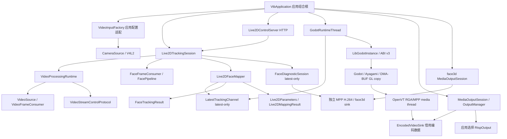

# Live2D 产品模块边界

2026-11-03：本轮调整模块依赖、职责与接口语义。安全审查、音频链路和硬件缓冲策略不在本轮范围。

## 为什么调整

原有 FaceTrackingService 同时包含算法装配、Live2D 映射、产品状态和 HTTP；视频工厂依赖
完整应用配置；渲染头文件通过值类型引入 mapper；通用会话受 RKNN/OpenCV 构建开关控制；
Godot 模块内部选择 RTSP 并持有 OutputManager。这些关系会扩大修改与编译范围。

本次把产品选择集中到 `apps/vtb-live2d`，低层算法与后端只保留自己的输入输出契约。
更小的做法是只移动文件，但仍会保留头文件传递依赖、硬件构建条件和 Godot 的 FFmpeg
链接依赖，因此同时调整这些实际边界。GPU、DMA-BUF、RGA、MPP 保留原线程和资源链。

## 当前依赖



箭头表示依赖或装配关系。编码数据由 `Media` 经 sink 回调进入宿主 `MediaOutputSession`。

| 位置 / 目标 | 责任与依赖限制 |
| --- | --- |
| `include/vtb/video`、`vtb_video_core` | 视频值类型、来源、同步消费者和源生命周期控制协议；不依赖 face、live2d、应用配置 |
| `vtb_capture` | V4L2 设备和缓冲区；只接收 `CaptureConfig` |
| `vtb_face_core` | 通用算法接口、流程与 FaceFrameConsumer；不包含 HTTP 或 Live2D 类型 |
| `vtb_live2d_values` | 参数与映射结果值类型；没有 face 或推理依赖 |
| `vtb_live2d_mapper` | 人脸结果到 Live2D 的校准、映射和平滑 |
| `vtb_live2d_tracking_session` | 应用会话，装配 runtime、face、mapper 和 LatestTrackingChannel；停止前等待消费者结束 |
| `vtb_live2d_control` | HTTP 解析与 JSON 状态序列化；借用会话的查询、取景、校准能力 |
| `vtb_application_video_input` | 应用配置转换为后端配置并选择摄像头实现 |
| `vtb_media_output_session` | 接收编码包、输出生命周期与统计；具体协议由组合根注入 |
| `vtb_face_diagnostic_output` | 把最新人脸值结果绘制为 NV12 诊断画面并独立 MPP 编码；不持有视频帧租约 |
| LibGodot 模块 | 渲染与既有 GPU/RGA/MPP 资源链；不编译 OutputManager、RTSP 或 FFmpeg |

`vtb_render_runtime` 保留为带替身后端的生命周期契约原型，仅由既有状态机单元测试使用。
产品生命周期入口为 `apps/vtb-live2d/vtb_application.cpp` 中的 `GodotRuntimeThread`；
它在专用所有者线程内管理 `LibGodotInstance`，并和 Godot 模块共享参数值与桥接头文件。
原型渲染头文件现在直接依赖参数值类型。

## 当前渲染与输出线程

产品启动参数显式固定 `--render-thread safe`，资源工程也固定
`rendering/driver/threads/thread_model=1`。在该模式下，Godot 所有者线程同时是 Godot
主线程和 `RenderingServer` 执行线程。`call_on_render_thread()` 检测到调用者就是
`server_thread` 后会直接执行捕获回调。
这里的“同一线程”指同一个 OS thread ID；Linux 调度器仍可让该线程在不同 CPU core
之间迁移，当前实现没有做 CPU 亲和性绑定。

```text
Godot 所有者兼渲染执行线程
  prepare_frame → iteration → RenderingServer draw
  → complete_frame → viewport texture → glBlitFramebuffer → glFinish
  → 发布 READY DMA-BUF slot
                    │
                    ▼
OpenVT RGA/MPP 媒体线程
  READY slot → RGA RGBA/NV12 → MPP H.264
  → EncodedVideoSink::publish → OutputManager 有界队列
                    │
                    ▼
RTSP Output 工作线程
  take_packet → RtspOutput::write → FFmpeg/RTSP
```

这里列出的是 Live2D 渲染到网络输出的三个主要 CPU 线程。摄像头采集、人脸消费、控制、
可选诊断、指标以及 Godot 内部工作池仍有各自线程。GPU 作为独立硬件执行图形命令；
`glFinish()` 是所有者线程等待本次 DMA-BUF 复制完成的同步点。

`call_on_render_thread()` 保留对 Separate 模式的正确路由能力。以后显式切换 Separate 时，
Godot 会创建 RenderingServer 线程，捕获回调通过命令队列转交；该模式需要重新进行完整
实机验收，不属于当前产品配置。

## 快照与帧租约语义

- `read_snapshot_if_changed()` 由 Godot 所有者线程单独消费。`nullopt` 表示快照没有变化；跟踪有效性由
  `mapping().tracking_valid()` 描述。
- `snapshot_generation` 随映射结果或取景状态更新递增；映射的 `frame_id()` 对应来源帧。
- `produced_timestamp_ns` 由项目级 `MonotonicClock` 产生，属于 Linux
  `CLOCK_MONOTONIC` 纳秒时间轴。取景更新保留这个时间，
  不能让过期的映射重新变新。
- Godot 没有收到新快照时保持最近参数；超过 150 ms 后以 250 ms 时间常数衰减到默认值。
  取景更新独立应用，过期快照不能把已经衰减的参数重置回旧值。
- `VideoFrameConsumer::consume()` 必须在返回前完成处理并释放租约。控制线程通过
  `VideoStreamControlProtocol` 在采集前确认 `begin_source`，在最后一帧后确认
  `retire_source`；消费者仍不能把租约或帧内存指针保存到返回之后。
- 可选人脸诊断只复制 `FaceTrackingResult`，后台槽位容量为一。它没有把
  `DecodedFrameLease` 变成多消费者总线，也不会让诊断编码背压延长 V4L2 租约。

## 编码包交接与关闭顺序

`EncodedVideoSink` 只包含上下文指针和同步函数指针。首次采集初始化时交付 H.264 SPS/PPS、
尺寸与帧率，然后单个媒体工作线程交付包字节、PTS/DTS、时长、帧序号与关键帧标志。
所有字节只在回调期间有效；回调不能跨边界抛出异常。宿主复制到自有 `MediaPacket` 后入队。

这是一次额外的编码字节复制，未复制未压缩像素。收益是输出协议更改无需重编 Godot；
本轮不宣称性能改善。以后是否减少这次复制，应由包大小、CPU、回调 P95/P99、队列深度与
丢包统计决定。回调返回 0 表示按既有队列策略处理成功；重连、等待关键帧或背压导致
`OutputManager::publish()` 返回 0 个入队出口时，保持原有恢复策略。

宿主先构造输出接收器，再启动 Godot 所有者线程，使异常展开时接收器仍有效。正常关闭顺序：

1. 停止 HTTP 与跟踪会话，确保不再发布新的人脸结果。
2. 停止并 join `FaceDiagnosticSession`，再排空 `/face3d` 输出。
3. `finish_application()` 停止渲染生产、排空编码队列并 join 媒体线程，释放引擎资源。
4. Live2D `MediaOutputSession::finish()` 最多等待 2 秒排空输出，再停止协议工作线程。
5. 销毁 LibGodot 实例。异常路径由 RAII 保证生产线程先退出、回调上下文后销毁。

编码/GPU 指标留在模块；实际协议写出、丢弃、错误、重连、队列深度和写出耗时由宿主
`VTB_OUTPUT_RESULT` 报告。编码完成与网络实际写出是不同计数。

## 配置与构建兼容性

- 把 `render.rtsp_url` 移到 `output.rtsp_url`；可选 `face_diagnostic_output` 配置第二路
  `/face3d`。解析器拒绝旧位置并提示迁移。
- 桥接使用 `openvt_libgodot_application_initialize_v3()`，启动检查 ABI 版本和配置尺寸；
  宿主与 LibGodot 必须成对构建、成对部署，不能混用历史二进制。
- Godot 模块只要求 `OPENVT_VTB_SOURCE_ROOT` 与 `OPENVT_BOARD_SYSROOT`；移除 FFmpeg 环境要求和链接库。
- `VTB_ENABLE_RGA_FACE` 独立控制 RGA 后端，`VTB_ENABLE_RKNN_FACE` 只控制 RKNN。
  产品还需要 OpenCV 几何、RTSP 和 embedded Godot 开关；通用组件不受这些开关限制。
- 历史 `render_dmabuf_video.gd` 场景须搭配 ABI v2 之前的完整二进制。当前模块不再提供
  GDScript 的 RTSP configure 入口，脚本检测后给出明确迁移提示。

## 验证范围

本轮进行源码边界检查、远端 x86_64 通用构建、ARM64 产品/LibGodot 编译和 ELF 依赖检查。
配置解析、单调计时器和 JSONL 持久化测试已通过；其他既有测试只参与编译。验证过程没有
调用业务接口、摄像头或板端运行。当前构建日志、源码清单与产物校验见
`build/remote-artifacts/vtb-metrics-persistence-20261103/MANIFEST.md`。
历史实机数据不能作为本轮 ABI v3 的运行验收。
