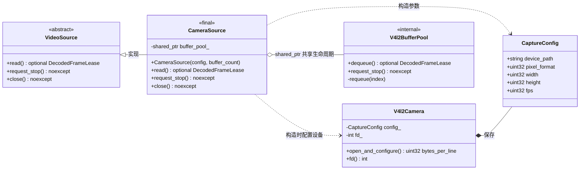
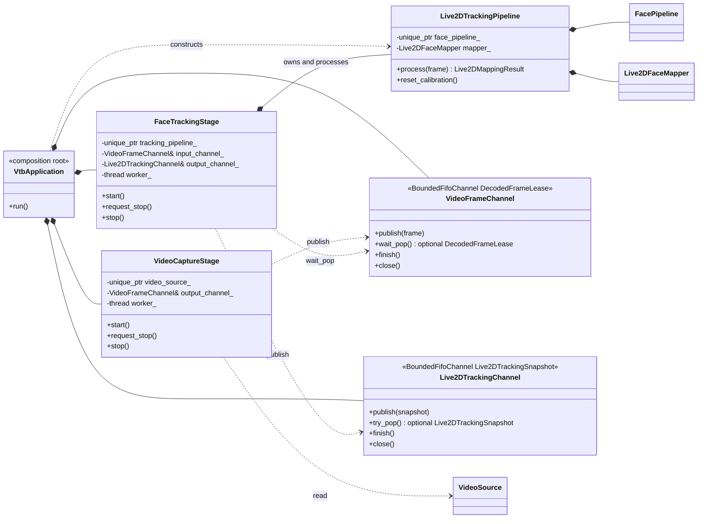
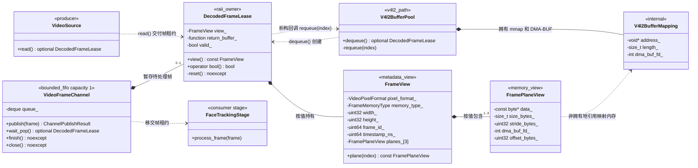

# 视频输入模块类图

本文只描述视频输入模块，图中的关系来自当前代码：

- `include/vtb/video/video_source.hpp`
- `include/vtb/video/video_frame_consumer.hpp`
- `include/vtb/video/camera_source.hpp`
- `include/vtb/video/v4l2/v4l2_buffer_mapping.hpp`
- `include/vtb/video/v4l2/v4l2_buffer_pool.hpp`
- `include/vtb/messaging/video/video_frame_types.hpp`
- `include/vtb/messaging/video/frame_plane_view.hpp`
- `include/vtb/messaging/video/frame_view.hpp`
- `include/vtb/messaging/video/decoded_frame_lease.hpp`
- `include/vtb/messaging/bounded_fifo_channel.hpp`
- `include/vtb/video/latest_frame_slot.hpp`
- `include/vtb/v4l2_camera.hpp`
- `include/vtb/pipeline/video_processing_runtime.hpp`
- `include/vtb/face/face_frame_consumer.hpp`
- `src/video/camera_source.cpp`
- `src/video/v4l2/v4l2_buffer_mapping.cpp`
- `src/video/v4l2/v4l2_buffer_pool.cpp`
- `src/messaging/video/frame_plane_view.cpp`
- `src/messaging/video/frame_view.cpp`
- `src/messaging/video/decoded_frame_lease.cpp`
- `src/video/latest_frame_slot.cpp`
- `src/pipeline/video_processing_runtime.cpp`
- `src/face/face_frame_consumer.cpp`
- `apps/vtb-live2d/pipeline/video_capture_stage.hpp`
- `apps/vtb-live2d/pipeline/face_tracking_stage.hpp`
- `apps/vtb-live2d/pipeline/live2d_pipeline_runtime.hpp`

## Doxygen + Graphviz 自动生成

自动生成配置位于 `docs/Doxyfile.video-input`。在项目根目录执行：

```bash
./scripts/generate-video-input-docs.sh
```

脚本会先清理专用 HTML 生成目录，防止已删除或重命名的类页面继续被静态服务访问。

生成入口为：

```text
build/docs/video-input-doxygen/html/index.html
```

关系图交互：

- 鼠标指针放在关系图内，按住 `Shift` 并滚动滚轮或触控板可缩放。
- 在关系图内按住鼠标拖动可平移。
- 左上角的 `+`、`-` 和方向按钮仍然可用。
- 右上角的箭头可在独立页面打开原始 SVG。

重点页面：

- `classvtb_1_1_video_source.html`：`VideoSource` 继承图。
- `classvtb_1_1_video_capture_stage.html`：摄像头采集线程与帧通道的边界。
- `classvtb_1_1_face_tracking_stage.html`：人脸处理线程的输入、输出与状态边界。
- `classvtb_1_1_live2_d_pipeline_runtime.html`：两个 Stage 和两条通道的装配关系。
- `classvtb_1_1messaging_1_1_bounded_fifo_channel.html`：通用有界 FIFO 的所有权和关闭语义。
- `classvtb_1_1_decoded_frame_lease.html`：`DecodedFrameLease`、`FrameView`、`FramePlaneView` 的协作关系。

`VideoProcessingRuntime`、`VideoFrameConsumer`、`FaceFrameConsumer` 和 `LatestFrameSlot`
仍保留源码与独立协议测试页面，用于记录旧通用运行时契约；产品主链路已经由上述
Stage 和 Channel 组合替代。

下面的 Mermaid 图是从自动图中筛选关键关系后的阅读版；Doxygen HTML 是完整的源码扫描结果。

## 视频源继承图



当前 `vtb-live2d` 的 `VideoInputFactory` 创建 `CameraSource`，并以
`std::unique_ptr<VideoSource>` 返回。`CameraSource` 直接使用 V4L2 MMAP 缓冲区、
`VIDIOC_DQBUF/QBUF` 和可用时的 `VIDIOC_EXPBUF`。项目当前只有这一种摄像头输入实现，
视频采集路径不依赖 OpenCV `VideoCapture`。
`V4l2Camera` 在 `ioctl` 返回后立即校验驱动回填值，只向缓冲池返回内存行跨度，
项目中不保存驱动协商配置对象。

## 当前 Stage 与通道装配图



`VideoCaptureStage` 只读取 `VideoSource` 并把 move-only 帧租约移入帧通道；
`Live2DTrackingPipeline` 构造时固定 `FacePipeline` 和 mapper 配置，只执行同步算法。
`FaceTrackingStage` 阻塞取得租约，在同一工作线程内调用该主体，再把值快照移入跟踪通道。
`VtbApplication` 在组合根直接实例化通道和 Stage，并在释放
这些局部对象前完成两个线程的 `join()`。通道不创建线程，也不要求消息类型继承公共基类。

## 视频帧协作与所有权图



### 所有权语义

1. `FramePlaneView` 只保存 CPU 地址或 DMA-BUF 文件描述符，不拥有像素内存。
2. `FrameView` 按值包含一到三个 `FramePlaneView`，负责描述格式、尺寸、帧号和时间戳，也不拥有像素内存。
3. `DecodedFrameLease` 是 move-only RAII 租约。租约有效期间，`FrameView` 指向的像素内存保持有效。
4. V4L2 路径的命名回调保存 `shared_ptr<V4l2BufferPool>` 和缓冲区索引；租约释放时调用 `requeue(index)`，执行 `VIDIOC_QBUF`。
5. `VideoFrameChannel` 当前容量为一并使用 `drop_oldest`。新帧替换旧帧或关闭通道时，
   被移出的租约在通道锁外析构并立即归还对应缓冲区。
6. `FaceTrackingStage` 从通道取得租约并同步处理；`process_frame()` 返回后租约自动释放。

## 关系图例

- `<|--`：继承/实现抽象接口。
- `*--`：组合或独占包含，被包含对象的生命周期受拥有者控制。
- `o--`：共享生命周期关系。
- `..>`：创建、调用、返回或者非拥有引用。
