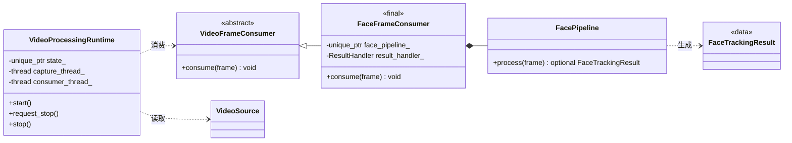
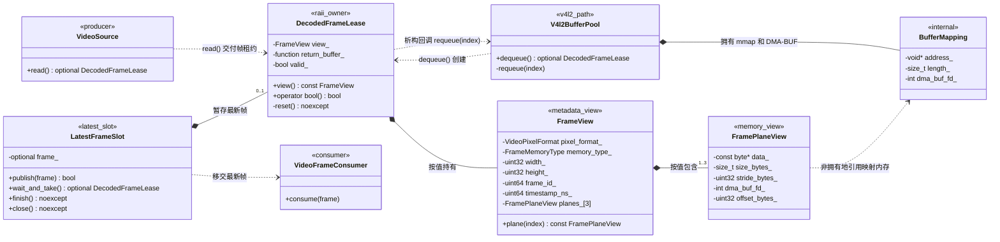

# 视频输入模块类图

本文只描述视频输入模块，图中的关系来自当前代码：

- `include/vtb/video/video_source.hpp`
- `include/vtb/video/video_frame_consumer.hpp`
- `include/vtb/video/camera_source.hpp`
- `include/vtb/video/frame.hpp`
- `include/vtb/video/latest_frame_slot.hpp`
- `include/vtb/v4l2_camera.hpp`
- `include/vtb/pipeline/video_processing_runtime.hpp`
- `include/vtb/face/face_frame_consumer.hpp`
- `src/video/camera_source.cpp`
- `src/video/frame.cpp`
- `src/video/latest_frame_slot.cpp`
- `src/pipeline/video_processing_runtime.cpp`
- `src/face/face_frame_consumer.cpp`

## Doxygen + Graphviz 自动生成

自动生成配置位于 `docs/Doxyfile.video-input`。在项目根目录执行：

```bash
./scripts/generate-video-input-docs.sh
```

脚本会先清理专用 HTML 生成目录，防止已删除或重命名的类页面继续被静态服务访问。

生成入口为：

```text
build/docs/video-input-doxygen/html/index.html
```

关系图交互：

- 鼠标指针放在关系图内，按住 `Shift` 并滚动滚轮或触控板可缩放。
- 在关系图内按住鼠标拖动可平移。
- 左上角的 `+`、`-` 和方向按钮仍然可用。
- 右上角的箭头可在独立页面打开原始 SVG。

重点页面：

- `classvtb_1_1_video_source.html`：`VideoSource` 继承图。
- `classvtb_1_1_video_frame_consumer.html`：统一视频帧消费接口。
- `classvtb_1_1_video_processing_runtime.html`：通用 latest-only 运行时。
- `classvtb_1_1_face_frame_consumer.html`：人脸管线消费适配器。
- `classvtb_1_1_latest_frame_slot.html`：`LatestFrameSlot` 与 `optional<DecodedFrameLease>` 的协作关系。
- `classvtb_1_1_decoded_frame_lease.html`：`DecodedFrameLease`、`FrameView`、`FramePlaneView` 的协作关系。

下面的 Mermaid 图是从自动图中筛选关键关系后的阅读版；Doxygen HTML 是完整的源码扫描结果。

## 视频源继承图


当前 `vtb-live2d` 的 `VideoInputFactory` 创建 `CameraSource`，并以
`std::unique_ptr<VideoSource>` 返回。`CameraSource` 直接使用 V4L2 MMAP 缓冲区、
`VIDIOC_DQBUF/QBUF` 和可用时的 `VIDIOC_EXPBUF`。项目当前只有这一种摄像头输入实现，
视频采集路径不依赖 OpenCV `VideoCapture`。
`V4l2Camera` 在 `ioctl` 返回后立即校验驱动回填值，只向缓冲池返回内存行跨度，
项目中不保存驱动协商配置对象。

## 帧消费接口图



`VideoProcessingRuntime` 不包含人脸头文件或结果类型。组合层选择
`FaceFrameConsumer` 时才进入 `FacePipeline`，以后可以增加编码、录像等消费者而无需
修改摄像头或运行时。所属控制线程负责运行时的启动、停止、等待和析构；两个工作线程
只访问由运行时独占的状态对象，运行时在释放状态对象前完成线程 `join()`。

人脸数据类位于 `face_types.hpp`，算法与适配位于 `face_pipeline.hpp`、
`face_frame_consumer.hpp`。应用会话、快照和 HTTP 控制位于 `apps/vtb-live2d`；
Live2D 映射结果位于独立的 `live2d_mapping_result.hpp`。应用装配关系见
[模块边界](module-boundaries.md)。消费者必须在 `consume()` 返回前释放帧租约；
当前接口不提供异步队列的停止和排空协议。

## 视频帧协作与所有权图



### 所有权语义

1. `FramePlaneView` 只保存 CPU 地址或 DMA-BUF 文件描述符，不拥有像素内存。
2. `FrameView` 按值包含一到三个 `FramePlaneView`，负责描述格式、尺寸、帧号和时间戳，也不拥有像素内存。
3. `DecodedFrameLease` 是 move-only RAII 租约。租约有效期间，`FrameView` 指向的像素内存保持有效。
4. V4L2 路径的命名回调保存 `shared_ptr<V4l2BufferPool>` 和缓冲区索引；租约释放时调用 `requeue(index)`，执行 `VIDIOC_QBUF`。
5. `LatestFrameSlot` 最多保存一个 `DecodedFrameLease`。新帧替换旧帧或关闭槽位时，旧租约析构并立即归还对应缓冲区。
6. `VideoProcessingRuntime` 把取出的租约移动给 `VideoFrameConsumer`；消费者返回后，
   租约自动释放。运行时不感知人脸结果类型。

## 关系图例

- `<|--`：继承/实现抽象接口。
- `*--`：组合或独占包含，被包含对象的生命周期受拥有者控制。
- `o--`：共享生命周期关系。
- `..>`：创建、调用、返回或者非拥有引用。
